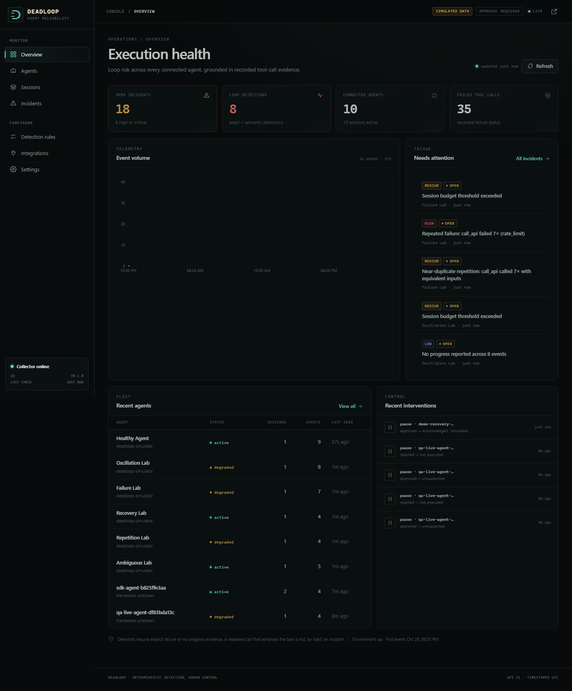

# DEADLOOP

**Deterministic detection for AI agents that don't know when to stop.**

DEADLOOP is an observability and human-control console for AI-agent execution. It
records tool-call traces, detects repetitive or unproductive loops with explainable
rules, preserves the exact evidence behind every finding, and lets an operator
acknowledge, resolve, dismiss, or request a pause.

The detector never asks a language model whether a loop happened. AI is an optional
narrative layer only; it cannot change a finding, lower a risk score, or execute an
intervention. A complete deterministic explanation is always available, including
when no AI provider is configured.



## Why it exists

Agents fail in quieter ways than services do. A web service returns a 500; an agent
can call the same search, edit the same file, or alternate between two broken steps
for an hour while every individual call looks valid. Generic tracing shows that the
calls happened. DEADLOOP answers the next questions:

- Is this repetition, or legitimate retrying?
- What exactly supports that conclusion?
- What should a human look at first?
- Can we stop the run without claiming control we do not have?

## What you get

- **Six deterministic detectors** for exact repetition, near-duplicate repetition,
  oscillation, repeated failure, explicit no-progress, and session budgets.
- **Evidence-first incidents.** Every finding cites event IDs, the observed sequence,
  measured metrics, confidence basis, and stated uncertainty.
- **Idempotent ingestion.** Duplicate event IDs and duplicate batches do not create
  duplicate incidents. Findings are fingerprinted and updated in place.
- **Secret redaction at two layers.** The SDK redacts credential-shaped fields before
  transport; the backend redacts again before storage and never returns raw ingestion
  keys after creation.
- **Safe interventions.** The default policy is `approval_required`. Only the demo
  simulator acknowledges a pause. A real runtime without an adapter is reported as
  `UNSUPPORTED`, never falsely marked paused.
- **Operator workflow.** Acknowledge, resolve, dismiss, add investigation notes, attach
  approval context, inspect the audit history, and filter the full session trace.
- **Local-first AI.** Optional OpenAI-compatible explanations work with a local model
  server. Detection remains on-device and deterministic either way.
- **Demo lab.** Isolated simulated scenarios for healthy activity, exact repetition,
  oscillation, repeated failure, ambiguous activity, and recovery. Demo data is marked
  in the UI and can be reset explicitly.

## How it works

```text
Agent / SDK ──X-API-Key──▶ ingest ──▶ redact + hash ──▶ SQLite/Postgres
                                      │
                                      ▼
                              deterministic detectors
                                      │
                                      ▼
                            incidents + cited evidence
                                      │
              ┌───────────────────────┼────────────────────────┐
              ▼                       ▼                        ▼
       operator triage       optional AI narrative      intervention policy
       ack/resolve/dismiss   (never detection)          approval + runtime ack
```

The React dashboard is served by the same FastAPI process in production. Admin
reads and operator actions use `X-Admin-Token`; write-only ingestion uses a hashed
`dl_...` API key.

## Quick start

Prerequisites: Python 3.11+, Node.js 20+.

### 1. Backend

```bash
cd backend
python -m venv .venv
# Windows: .venv\Scripts\activate
# macOS/Linux: source .venv/bin/activate
pip install -r requirements.txt
python -m alembic -c alembic.ini upgrade head
```

Set an admin token and run from `backend/`:

```powershell
# PowerShell
$env:DEADLOOP_ADMIN_TOKEN = "choose-a-long-random-token"
$env:DEADLOOP_AUTO_CREATE = "0"
python -m uvicorn app.main:app --host 127.0.0.1 --port 8000
```

```bash
# macOS/Linux
export DEADLOOP_ADMIN_TOKEN="choose-a-long-random-token"
export DEADLOOP_AUTO_CREATE=0
python -m uvicorn app.main:app --host 127.0.0.1 --port 8000
```

If no token is set in development, the backend uses `dev-admin-token`. It refuses
to start with that default when `DEADLOOP_ENV=production`.

### 2. Frontend

For a production-style run, build the SPA and let FastAPI serve it:

```bash
cd frontend
npm ci
npm run build
```

Then open `http://127.0.0.1:8000` and sign in with the admin token.

For frontend development with hot reload:

```bash
cd frontend
npm ci
npm run dev
```

Vite runs on `http://127.0.0.1:5173` and proxies `/api` to `http://127.0.0.1:8000`.

### 3. Send a first trace

Create a key in **Integrations**, install the SDK, and emit events:

```bash
cd sdk
pip install -e .
```

```python
from deadloop import DeadloopClient

with DeadloopClient(
    endpoint="http://127.0.0.1:8000",
    api_key="dl_...",
    agent_id="support-agent",
    session_id="ticket-4821",
) as client:
    client.emit(
        "search_web",
        action="Find the refund policy",
        input={"query": "refund policy"},
        output={"results": 3},
        status="success",
        progress=True,
    )
```

Or try the isolated simulator on **Integrations → Demo lab**. The *Exact repetition*
scenario creates four identical failing calls and should produce both exact-repetition
and repeated-failure findings.

## Docker

```bash
# Create a local .env and replace the admin token placeholder.
cp .env.example .env

docker compose up --build
```

Open `http://127.0.0.1:8000`. The container runs Alembic before starting, disables
automatic schema creation, stores SQLite data in the `deadloop-data` volume, binds
to localhost by default, and runs as a non-root user with a read-only root filesystem.

Do not expose this single-admin console directly to the public internet without TLS,
a reverse proxy, and an authentication decision appropriate to your deployment. See
[deployment](docs/deployment.md) and [security](docs/security.md).

## Tests

```bash
cd backend && python -m pytest -q
cd sdk && python -m pytest -q
cd frontend && npm run test
cd frontend && npm run build
```

The current suite covers detection semantics, idempotency, API authentication and
authorization, payload validation, redaction, incident workflow, intervention policy,
AI fallback behavior, clean-database migrations, and the end-to-end acceptance path.
The verified results and environment are recorded in [VERIFICATION.md](VERIFICATION.md).

## Documentation

- [Architecture](docs/architecture.md)
- [Detection semantics](docs/detection.md)
- [Security model](docs/security.md)
- [API and authentication](docs/api.md)
- [Deployment](docs/deployment.md)
- [SDK reference](sdk/README.md)
- [QA verification report](VERIFICATION.md)

## Scope and honest limits

- This is a single-operator console, not a multi-tenant RBAC platform.
- SQLite is the default and is suitable for local or single-node use. A production
  database adapter/migration is not included in this initial release.
- The only connected intervention adapter is the demo simulator. Other agents are
  reported as `UNSUPPORTED`; DEADLOOP does not pretend to control them.
- Live AI-provider connectivity is optional and was not exercised against a real
  provider during verification. Mocked provider tests and the real deterministic
  fallback path were verified.
- No open-source license has been selected yet. Add one before distributing the code.

## Status

Version `0.1.0`. The product was implemented from an empty repository and verified
against the specification in October 2026.
